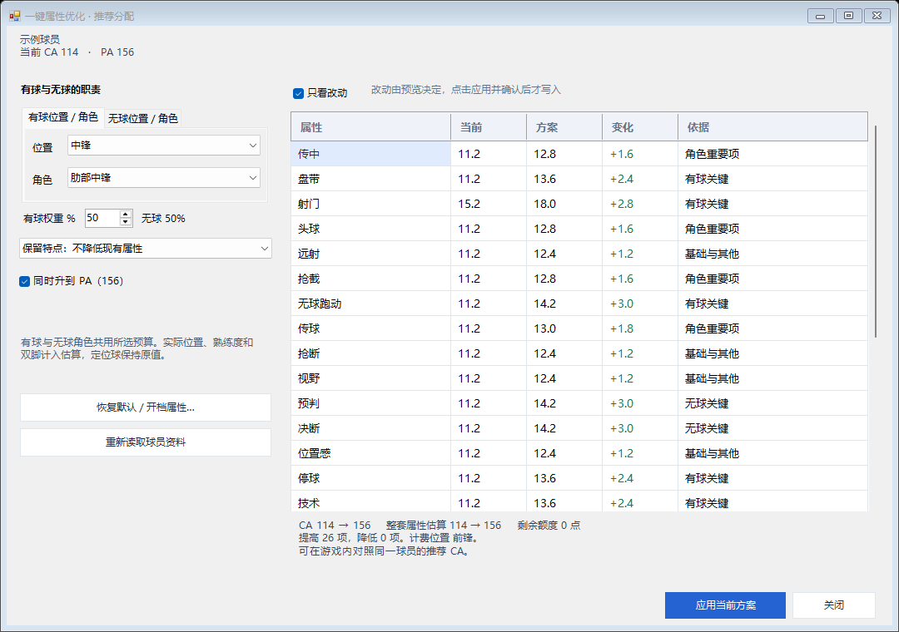

# 一键属性优化与原值恢复

球员资料和 CA 成长页都可以打开“一键属性优化”。进入时自动成长会暂停，方便核对同一时间点的属性。

## 按当前 CA 或 PA 分配

默认使用球员当前 CA。勾选“同时升到 PA”后，以该球员在存档中的确定 PA 为预算，应用时一次提高 CA 和预览所列属性。有球和无球可分别选择位置、角色和权重。任一启用阶段的核心项归蓝，其余重要项归绿，权重用于同档排序。属性成本来自球员的实际位置、熟练度、原始属性和双脚水平。

默认“保留特点”以各项现值为下限，依次补蓝、绿、白。若当前 CA 140、原有属性估算需要 145 点、PA 为 165，勾选“同时升到 PA”可使用其余预算。原值超出预算时，预览显示差额。

“重新分配”以蓝 17、绿 15、白 12、其余 10 为目标。预算不足时依次降低其余、白、绿、蓝，常规下限分别为 6、8、12、12。极低 CA 下进一步放宽下限。四档达标后的余量优先用于蓝档，再用于绿档。保护属性保留原值，其中有成本的项目仍计入预算。

预览显示 CA 的变化、优化前后估算值、各档达标数、预计区间、被压低项与保留项。只看改动时仍能查看未达标的蓝绿项。点击“应用当前方案”并确认后，按预览提交。写入前重新检查位置、双脚、完整属性、当前 CA/PA、所属球队和游戏日。CA 与属性可在变更记录中一起撤销。

## 推荐 CA 的估算依据

修改器读取 1–100 的内部属性精度。15 个实际位置对应 10 组权重。左右侧保留独立熟练度，也计入多位置组合的成本。门将使用单独的权重。各位置分别按加权平均、双脚和属性分布做迭代修正，乘熟练度后取最高值。相同属性从不同起点提高，最终消耗可能不同。估算保留超过 200 的数值，以免把游戏显示上限当成剩余额度。[ChoreaW 的实验与位置权重表](https://www.playgm.cc/thread-986285-1-1.html) · [FM27 Scout 的计算实现](https://github.com/shlk20/fm27-scout-code/blob/7fb12175f59b4d41b4418bf0378c3855a5bab4bd/crates/fm27-core/src/ability.rs)

权重表来自 FM26 赛前编辑器研究。已对照作者公布的单位置、双脚和多位置示例，并用 360 组分布核对实现。在 FM27 的一名前锋身上，用户实际应用后，游戏推荐 CA 和本工具预览均为 195。其他位置的实机覆盖见[验证范围](../VALIDATION.md)。

## 恢复默认或开档属性

在当前球员的优化窗口点击“恢复默认／开档属性…”，再选来源。

- “读取游戏数据库默认值…”从本机 FM27 安装目录读取原版球员资料。只有一套 FM27 数据库时自动找到文件。有多套或无法自动找到时，可选择对应 27xx_fm 目录中的 people_db.dat。预览会标出数据库版本和该球员身份。数据库中定为 0 的项目显示“开档生成”并保留当前值。补丁改变的属性以本生涯开档副本为准。
- “选择开档或早期 .fm…”读取所选文件在显示日期保存的属性，保留内部精度。要恢复生涯初始值，请选当时另存的文件，含补丁、自定义和生成球员的实际值。FM 的 last save overwrite backup.fm 是最近一次被覆盖的存档副本。[SEGA 存档支持说明](https://support.sega.com/hc/en-gb/articles/19429026666769-What-should-I-do-if-my-save-game-no-longer-loads-in-Football-Manager)

核对球员 UID、来源和逐项差异。默认恢复有来源值的可见属性，含门将和定位球。可另勾选“同时恢复惯用脚与隐藏属性”和“同时恢复来源 CA”；来源 CA 有确定值并且在当前 PA 范围内才可选。点击“应用恢复”并确认，变更记录可整组撤销。请保留完整版内的 third-party 文件夹供读取来源文件使用。
