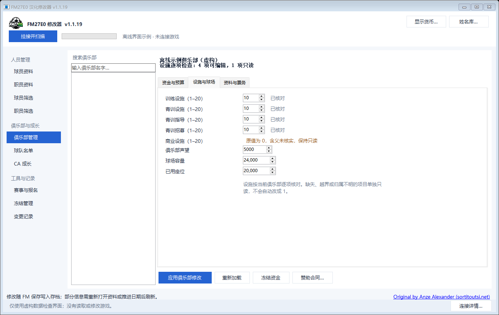

# 设施逐项检查与编辑

从 v1.1.21 起适用。逐项检查最初在 v1.1.19 引入，起因是“设施值在 1–20 范围内 1,620/1,708”的玩家反馈。v1.1.21 新增 Xbox PC 测试配置，Steam 27.1 的商业设施位置经安装文件核对。

## 为什么原来会整组只读

旧检查要求至少 95% 的抽样俱乐部同时通过全部五项设施检查。1,620/1,708 约为 94.85%，少于所需的 1,623 家，因此关闭整组设施编辑。这条比例不说明所有设施都异常，也不能确定未完整通过的 88 家具体是哪项、何种原因。

## 当前处理

- 逐俱乐部、逐设施检查用于已匹配的 Steam 27.0.1+2503222、Steam 27.1.0+2505117 和 Xbox PC 27.1.0+2505117。至少有一项通过时开放入口，实际编辑由所选俱乐部的各字段检查决定。
- 训练设施、青训设施、青训指导、青训招募和商业设施独立检查。某俱乐部商业设施异常，不会连带锁住其有效训练或青训项目，也不会锁住其他正常俱乐部。
- 原值为 0 的含义尚未核实，保持只读并直接显示原因，不把它变成等级 1。超出 1–20、不可读、缺少资料、对象归属不符、配置未映射或多个副本不一致，分别说明原因。
- 未核实的构建／自定义布局保留原有 95% 整体门槛。核心检查不通过、显式未映射或原生证明失效时，不会通过本修复绕开检查。

“连接详情”和变更记录同时列出五项完整通过的俱乐部数、逐字段有效数、0 值、越界、缺失、不可读、归属和副本冲突计数，以及有限数量的俱乐部 UID 示例。连接简报在存在部分只读项目时明确告知，不再称为全部通过。

## 归属、写入与撤销

每项核对俱乐部类型、UID、当前资料／财务指针和完整读取结果。商业设施只从经过确认的完整财务对象读取；轻量财务对象不读取完整财务字段。当前原生适配使用资料块的训练／青训字段，以及完整财务块的商业设施字段。

应用前预检当前连接、布局、身份和旧值，仅写入用户修改的已验证项目。一次设施操作成组写入，逐字节回读并检查最终整组结果。部分失败时恢复已确认属于本次操作的改动；遇到他人／游戏改动时不会覆盖未知新值。无法确认恢复完整时明确要求重载存档。撤销同样先核对整组，失败不标记已撤销，并尝试恢复撤销前状态。

## 如何使用

运行修改器后重新挂接，在“俱乐部管理 → 设施与球场”选择俱乐部。通过检查的设施显示数值与“已核对”，异常项目显示只读原因。“应用俱乐部修改”提交所选变动，“变更记录”提供撤销入口。

图中俱乐部和数据为离线示例；商业设施原值 0 是测试输入，不代表报告中的异常均为 0。

## 核对范围与边界

设施回归检查包含 1,620 家完整正常、88 家商业设施异常的模拟比例，以及正常字段独立编辑、错误类型、连接变化、写入失败、回读、回滚与整组撤销。设施页在 1120×720、1360×860、1600×960 下使用离屏窗体检查。

v1.1.20 已对 Steam 27.1 的设施做过实际游戏只读核对。v1.1.21 使用公开配置与模拟数据检查 Xbox PC，并从 Steam 27.1 安装文件核对商业设施位置为完整财务对象的 +0x8AD。实际 Xbox 连接、设施修改和保存重载仍待核对。详见 [Xbox PC 适配](xbox-pc-and-roster.md)。

## 布局参考

交叉核对了公开项目 Football-Manager-27-Editor 的固定提交 cfc80fdd336e553a18fe08738321079274e66836：

- [ClubFields.cs](https://github.com/Jackhamerp24/Football-Manager-27-Editor/blob/cfc80fdd336e553a18fe08738321079274e66836/src/Fm27Editor.Core/Clubs/ClubFields.cs)：设施位置及商业设施对完整财务类型的要求。
- [Steam 27.0.1+2503222 配置](https://github.com/Jackhamerp24/Football-Manager-27-Editor/blob/cfc80fdd336e553a18fe08738321079274e66836/offsets/27.0.1%2B2503222-steam.json)：对应构建配置。

字节存储范围不等于游戏语义。上述资料没有确立原值 0 可安全当作等级 1 或“无设施”，因此仍保留只读。
